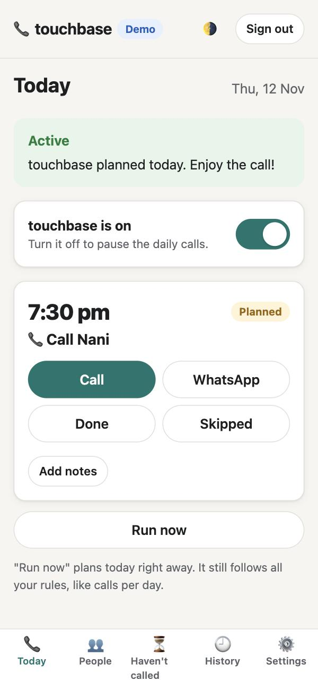
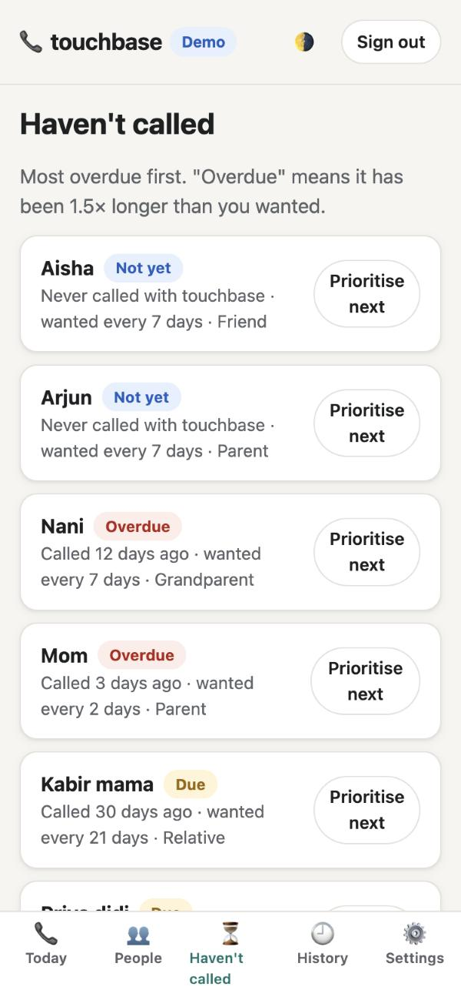
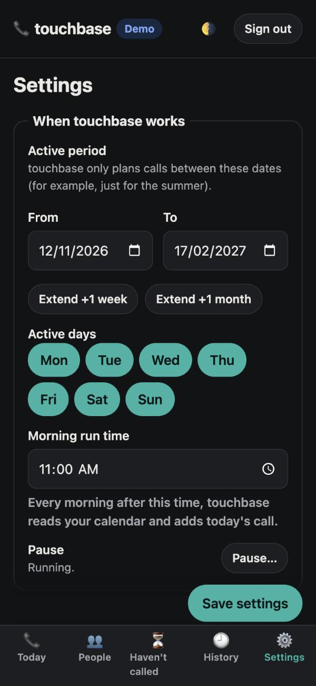

# touchbase

**One short call a day with someone you care about.**

Even with free time, it's easy to go weeks without calling family and close friends, especially if you're an introvert.
touchbase reads your Google Calendar every morning, finds a free 10–15 minutes later that day, picks the person you've gone longest without calling, and adds **one** "📞 Call Mom" event. **For today only**: no calendar spam.

<p>
  
  
  
</p>

## What it does
- **Every morning** (after a time you pick, e.g. 11:00), it reads your calendar and plans **today's** call. Nothing for tomorrow, nothing for next week.
- **Who:** the person who is most overdue, measured as days since your last call ÷ how often you want to talk to them. Mom every 2 days and a cousin every 3 weeks both get fair turns.
- **When:** the first free slot in your call window (e.g. 7:30–10 pm), away from your other events, and only when the other person is awake if they live abroad.
- **Reminder:** Google Calendar's own notification on your phone. The event has a **one-tap Call** button, a **one-tap WhatsApp/SMS heads-up** ("Hey Mom! Free for a quick call around 8:15 pm?") sent from *your* number, and 3 talking points.
- **It remembers:** write a line after the call ("Dad is planning a Goa trip"), and touchbase shows it before your next call with them.
- **It keeps up with your day:** if a meeting lands on the call, it moves the call. If you delete the event, it's skipped and not replaced.

## You stay in control
| Setting | What it does |
|---|---|
| **Pause / Resume** | A big switch on the Today screen. Optionally "pause until" a date, and remove today's call. |
| **Active period** | Only plan calls between two dates (e.g. just for the summer). **Extend +1 week / +1 month** buttons. |
| **Active days** | Monday to Sunday. Switch off any day. |
| **Morning run time** | When the daily plan runs (05:00–12:00). |
| **Calls per day** | 1 (default), 2 or 3. Never more. |
| **Call windows** | The hours you're happy to take calls, per weekday. |
| **Haven't called** | Everyone sorted by how overdue they are, with **Prioritise next**. |
| **History** | Past calls, Done/Skipped, notes. |

## Try it in one minute (no Google account needed)
Demo mode uses a pretend calendar, sample people and a temporary database.
```bash
git clone https://github.com/Tusharcode007/touchBase.git
cd touchBase
npm install
DEMO_MODE=true npm run dev
```
Open http://localhost:5173 and press **Try the demo**. Needs Node.js 22+.

## Use it for real
Follow **[docs/DEPLOY.md](docs/DEPLOY.md)**: MongoDB Atlas, Google Cloud, Render and GitHub Actions, all on free tiers, about 30 minutes.

## How it works
```
GitHub Actions (every hour) ──secret──▶ /api/internal/tick
                                          │
                     ┌────────────────────┴────────────────────┐
                     │ daily job: settle → check switches →    │
                     │ morning plan (once) or conflict check   │
                     │        ▼                                │
                     │ pure planner (all the rules, no I/O)    │
                     └───────┬───────────────┬─────────────────┘
                             ▼               ▼
                    Google Calendar      MongoDB (encrypted
                    (own events only)    phones, notes, token)
React dashboard ──session + CSRF──▶ /api (people, settings, history)
```
- **Server:** Node.js, Express 5, TypeScript, MongoDB (Mongoose), Luxon for timezones.
- **Web:** React 19 + Vite. No router or UI library.
- **Rules live in one pure function** (`server/src/core/planner.ts`), so they're easy to test.
- More: [ARCHITECTURE](docs/ARCHITECTURE.md) · [FLOW](docs/FLOW.md) · [DATA](docs/DATA.md).

## Security and privacy
- Only the emails in `ALLOWED_EMAILS` can sign in (checked on every request).
- Google sign-in with a one-time `state` and PKCE. touchbase asks for the **narrowest** calendar scopes: it can only create/edit events on calendars you own.
- Google token, phone numbers and notes are **encrypted** (AES-256-GCM). The browser never sees the Google token.
- Server-side sessions (`HttpOnly`, `Secure`, `SameSite=Lax`), CSRF protection, a strict Content-Security-Policy, rate limits, and input checks on everything.
- touchbase **never reads the titles** of your other events, only their times.
- **No automatic messages** to your contacts. You send the heads-up yourself, with one tap.
- Optional AI talking points send only a first name, the relation and your notes. **Never phone numbers.**
- **Delete everything** any time: Settings → Danger zone (also revokes Google access).

See [SECURITY.md](SECURITY.md), the [threat model](docs/THREAT.md) and the [security review](docs/SECURITY-REVIEW.md).

## Environment variables
| Name | Needed | What it is |
|---|---|---|
| `APP_URL` | yes | The address of the app, e.g. `https://touchbase.onrender.com` |
| `MONGODB_URI` | yes* | MongoDB connection string |
| `SESSION_SECRET` | yes* | Random secret for session cookies (`npm run secrets`) |
| `TOKEN_ENCRYPTION_KEY` | yes* | 32-byte base64 key for encryption at rest (`npm run secrets`) |
| `CRON_SECRET` | yes* | Shared secret for the hourly GitHub Actions tick (`npm run secrets`) |
| `GOOGLE_CLIENT_ID`, `GOOGLE_CLIENT_SECRET` | yes* | From Google Cloud → OAuth client |
| `ALLOWED_EMAILS` | yes* | Comma-separated emails that may sign in |
| `ANTHROPIC_API_KEY` | no | Turns on AI talking points |
| `DEMO_MODE` | no | `true` = fake calendar + sample data (refused in production) |
| `NODE_ENV` | in production | Must be `production` for a public `APP_URL` |

\* Not needed in demo mode. The server refuses to start if a required value is missing or looks weak.

## Commands
| Command | What it does |
|---|---|
| `npm run dev` | Server (:3000) + dashboard (:5173) with live reload |
| `npm run check` | Lint + typecheck + all tests (121 tests) |
| `npm run build` | Production build |
| `npm start` | Run the production build |
| `npm run secrets` | Print fresh random secrets for `.env` |

## Project layout
```
server/src/core/      the rules (pure functions): planner, guards, time maths, event text
server/src/jobs/      the daily job that applies the plan
server/src/calendar/  Google Calendar + a fake calendar for demo/tests
server/src/auth/      Google sign-in, sessions, CSRF, cron secret
server/src/routes/    the API
web/src/              the React dashboard
shared/               input rules (zod) and API types used by both sides
docs/                 how it works and why (start with docs/README.md)
```

## Docs
The [docs folder](docs/README.md) explains every decision, the threat model, the failure modes, how to test and how to roll back. Each file answers one of four questions: *why X instead of Y? what if someone is malicious? which data structure, and why? where does it fail?*

## License
[MIT](LICENSE)
